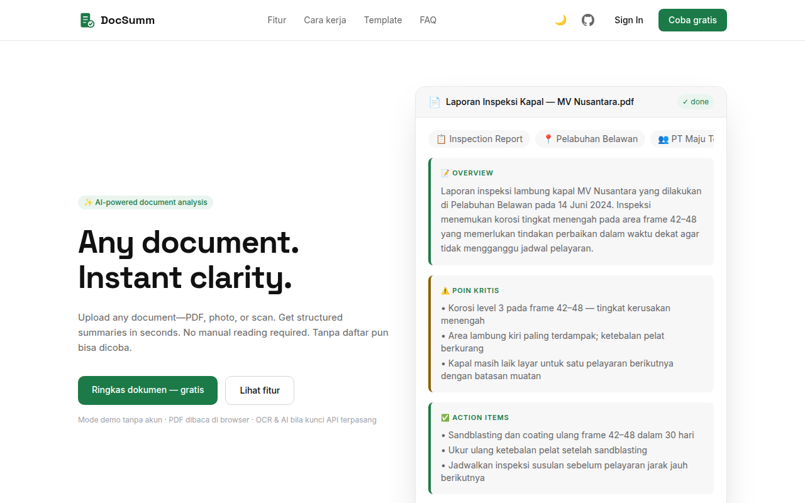
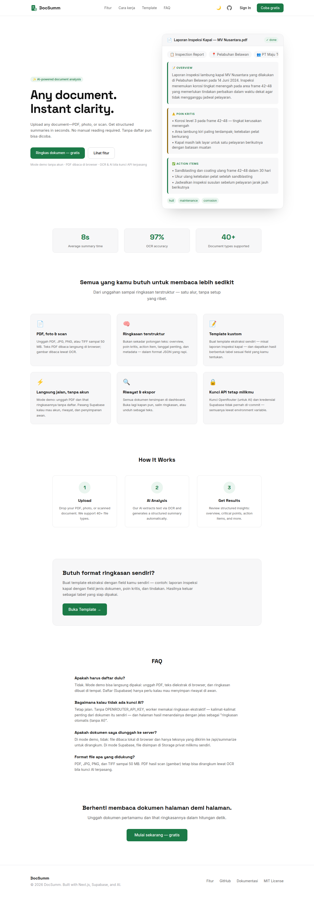
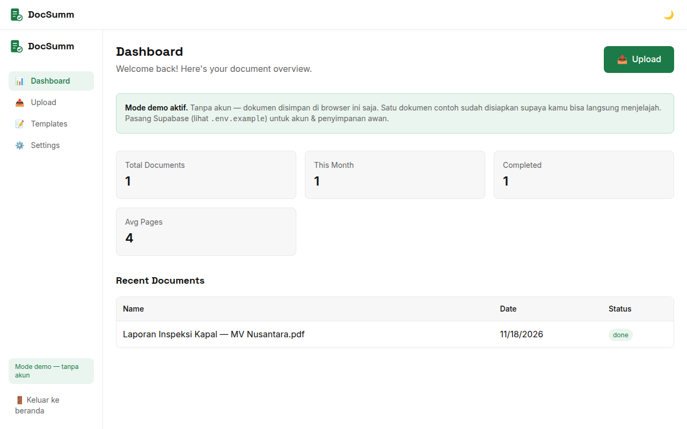
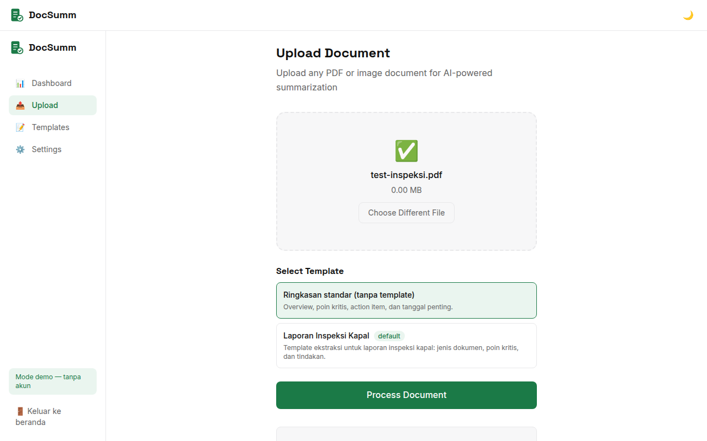
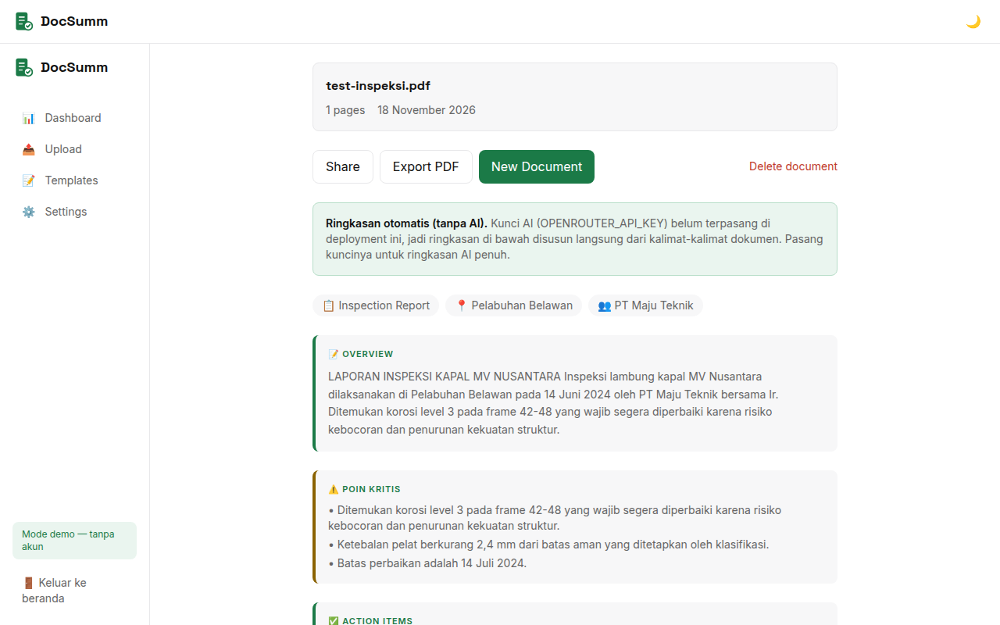
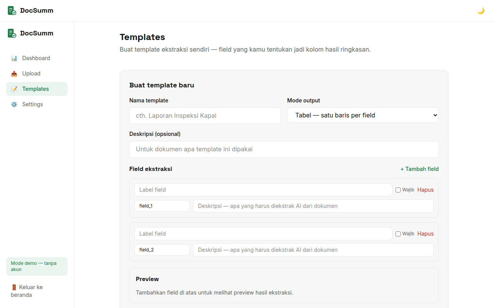
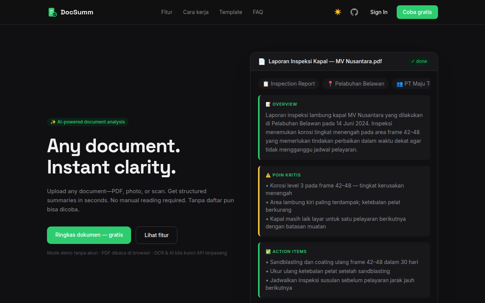

# DocSumm

**Any document. Instant clarity.**

DocSumm mengubah dokumen — PDF, foto, atau hasil scan — menjadi ringkasan
terstruktur yang bisa langsung dipakai: overview, poin kritis, action item,
tanggal penting, dan metadata (jenis dokumen, pihak terlibat, lokasi, tag).
Template kustom memungkinkan format ringkasan yang berbeda untuk setiap
jenis dokumen ("Build Your Own Summary Model").

🌐 **Live:** https://docsumm.pages.dev
📦 **Repo:** https://github.com/dezzorigin/docsumm



## Demo

| | |
|---|---|
| 🎥 Video demo (12 detik) | [docs/demo/demo.mp4](docs/demo/demo.mp4) |
| 📄 PDF contoh untuk dicoba | [docs/demo/test-inspeksi.pdf](docs/demo/test-inspeksi.pdf) — unggah di halaman Upload, ringkasannya harus memuat "MV Nusantara", "korosi", dan "14 Juli 2024" |

Tanpa akun pun bisa langsung mencoba: buka live site → **Coba gratis** →
dashboard sudah berisi satu dokumen contoh + satu template contoh.

## Screenshot

| Landing | Dashboard |
|---|---|
|  |  |

| Upload | Hasil ringkasan |
|---|---|
|  |  |

| Template | Settings / Dark mode |
|---|---|
|  |  |

Semua screenshot diambil dari play-test headless end-to-end
(lihat `docs/screenshots/`).

## Fitur

- **Upload PDF / gambar** — teks PDF diekstrak di browser (pdfjs-dist);
  gambar di-OCR via worker (butuh kunci AI).
- **Ringkasan terstruktur** — mode kartu (overview, poin kritis, action
  item, tanggal penting, metadata) atau mode tabel (template kustom).
- **Template kustom** — buat field sendiri, jadikan default, pilih saat upload.
- **Dashboard** — statistik nyata + daftar dokumen + hapus.
- **Mode demo** — tanpa akun, tanpa setup: dokumen + template di
  localStorage, satu dokumen contoh ter-seed otomatis.
- **Mode Supabase (opsional)** — Auth + Postgres + Storage dengan RLS.
- **Dua mesin ringkasan** — AI (OpenRouter/Gemini) bila kunci terpasang;
  ekstraktif lokal bila tidak. UI menulis jujur mesin mana yang dipakai.
- **Tema gelap/terang** — tersimpan di localStorage.

## Cara jalan (lokal)

```bash
npm ci
npm run build   # copy-pdf-worker + next build + salin worker ke out/
npm run serve   # sajikan out/ + worker di http://127.0.0.1:8331
```

Perintah lain:

```bash
npm run dev        # Next.js dev server (port 3000)
npm run typecheck  # tsc --noEmit
npm run lint       # eslint
npm test           # unit test worker (16 test, node --test)
```

### Environment (opsional — tanpa ini aplikasi mode demo)

Salin `.env.example` ke `.env.local`:

```env
# Supabase (aktifkan mode akun + penyimpanan awan)
NEXT_PUBLIC_SUPABASE_URL=https://<ref>.supabase.co
NEXT_PUBLIC_SUPABASE_ANON_KEY=<anon key>

# OpenRouter (aktifkan ringkasan + OCR AI penuh)
OPENROUTER_API_KEY=<key>
```

- Tanpa Supabase → mode demo (lihat `docs/DEMO.md`).
- Tanpa OpenRouter → ringkasan ekstraktif (lihat `docs/API.md`).
- `SUPABASE_SERVICE_ROLE_KEY` **tidak dipakai** — jangan tambahkan.

## Arsitektur

```
Browser (Next.js 16 static export, out/)
   │  PDF → teks diekstrak di browser (pdfjs-dist)
   │  Dokumen/template → localStorage (demo) atau Supabase (mode akun)
   ▼
Cloudflare Pages (docsumm.pages.dev)
   └─ Pages Worker (worker/_worker.js, tanpa dependensi)
        ├─ POST /api/summarize   AI (Gemini via OpenRouter) atau ekstraktif
        ├─ GET  /api/status      health + mode + mesin
        ├─ GET  /auth/callback   tukar PKCE code → sesi Supabase
        └─ guard /app/* + fallback shell /app/result/<id>
   ├─ OpenRouter (opsional, bila OPENROUTER_API_KEY ada)
   └─ Supabase Auth + Postgres + Storage (opsional, bila env terpasang)
```

Diagram lengkap (HTML+SVG): [`docs/DIAGRAMS.html`](docs/DIAGRAMS.html).

## Dokumentasi

| Dokumen | Isi |
|---|---|
| [`PRD.md`](PRD.md) | PRD v2.0 — masalah, fitur F1–F12, kriteria penerimaan |
| [`docs/ARCHITECTURE.md`](docs/ARCHITECTURE.md) | Arsitektur, struktur folder, alur data & auth |
| [`docs/DIAGRAMS.html`](docs/DIAGRAMS.html) | 3 diagram SVG |
| [`docs/API.md`](docs/API.md) | Endpoint worker |
| [`docs/DEPLOYMENT.md`](docs/DEPLOYMENT.md) | Build, deploy Pages, env, 7 jebakan yang diperbaiki |
| [`docs/DEMO.md`](docs/DEMO.md) | Mode demo + mesin ekstraktif |
| [`docs/SECURITY.md`](docs/SECURITY.md) | Secret, RLS, aliran data |
| [`docs/SCHEMA.md`](docs/SCHEMA.md) + [`supabase/schema.sql`](supabase/schema.sql) | Skema database |
| [`docs/COMPONENTS.md`](docs/COMPONENTS.md) | Katalog komponen |
| [`docs/DESIGN.md`](docs/DESIGN.md) | Design system + token |
| [`docs/PLANNER.md`](docs/PLANNER.md) | Sprint + status proper v1.0 |
| [`docs/README.md`](docs/README.md) | Indeks dokumentasi |

## Deployment

```bash
npm run build
python3 ~/workspace/github-actions/cf_pages.py deploy docsumm out
```

Detail: [`docs/DEPLOYMENT.md`](docs/DEPLOYMENT.md).

## Lisensi

MIT — lihat [LICENSE](./LICENSE).

---
Dikembangkan oleh **dezzorigin** (Nabil Aulia Dika).
